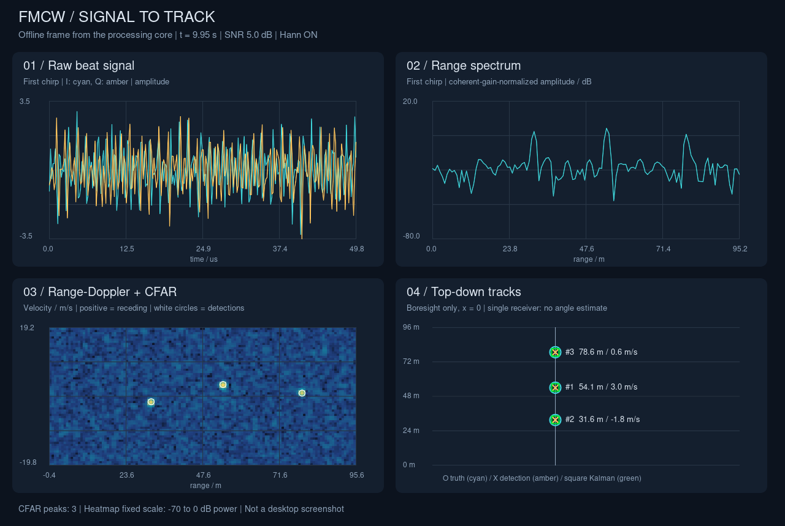

# FMCW radar: signal to track

A small C++17 radar demo: analytic I/Q echoes → Hann + range FFT → Doppler FFT
→ 2D CA-CFAR → constant-velocity Kalman tracks. The desktop application uses
raylib 5.5 (GLFW/OpenGL). The processing library only needs the C++ standard
library, and contains no graphics calls.

## Build and run on Linux

Ubuntu/Debian, with an X11 desktop or XWayland and OpenGL 3.3:

```sh
sudo apt install build-essential cmake git libasound2-dev libx11-dev libxrandr-dev libxi-dev libgl1-mesa-dev libglu1-mesa-dev libxcursor-dev libxinerama-dev
cmake -S . -B build -DCMAKE_BUILD_TYPE=Release
cmake --build build -j
ctest --test-dir build --output-on-failure
./build/radar_demo
```

CMake FetchContent downloads the raylib `5.5` tag, including its bundled GLFW;
network access is needed the first time. No separate FFT or GUI library is needed.
To use a previously downloaded raylib source tree offline, add
`-DFETCHCONTENT_SOURCE_DIR_RAYLIB=/absolute/path/to/raylib` to the configure command.

For tests and an offline plot without downloading graphics dependencies:

```sh
cmake -S . -B build-core -DRADAR_BUILD_UI=OFF -DCMAKE_BUILD_TYPE=Release
cmake --build build-core -j
ctest --test-dir build-core --output-on-failure
./build-core/radar_headless --frames 200 --output radar-frame.svg
```

If CMake itself is missing, `./scripts/build-core.sh` compiles the same core,
headless executable and tests using `g++` (or `$CXX`). Then run
`./build-local/radar_headless`. This fallback does not build the desktop UI.

**Validation in the delivery environment:** the actual C++ processing chain,
headless SVG export and tests have been compiled and run with `g++`. A 200-frame
run produced three confirmed tracks and took approximately 4.4 ms per frame on
this machine. CMake and the desktop application have **not** been run here:
CMake/raylib and some graphics development headers are absent, and terminal
network access cannot resolve GitHub. This is a remaining verification step,
not a successful GUI test. See [docs/validation.md](docs/validation.md).

## Demo controls

- Drag SNR to see the beat waveform and spectral noise floor change. SNR refers
  to a unit-amplitude echo before processing, independent of target count.
- Drag target count from 1 to 3; changing count restarts the preset scene and
  tracker. Target range, radial velocity and amplitude can also be set via CLI.
- Drag CFAR threshold (a **linear power multiplier**, not dB). A lower threshold
  admits more noise detections; a higher threshold can lose weak targets.
- Toggle Hann on/off in **both** FFT dimensions to show the sidelobe/main-lobe
  tradeoff. The FFTs compensate for coherent window gain.
- Space pauses/resumes; R resets the scene and noise seed; Escape exits.
  Parameter changes take effect on the next processed frame, so resume to see
  changes while paused. The GUI draws at up to 60 FPS; radar updates default to
  20 Hz with a 50 ms simulation step. Heavy configurations can run slower than
  real time; simulated timestamps remain fixed-step.

The four panels show first-chirp I/Q, first-chirp range amplitude in dB, a fixed
−70…0 dB power heatmap with white CFAR circles, and radial tracks viewed from
above. Truth is a cyan circle, measurements are amber crosses, and confirmed
Kalman estimates are green squares with IDs. Grey squares coast through missed
detections. Range-spectrum/heatmap range axes are **apparent beat range**;
measurements and tracks apply the small Doppler range correction below.

## Configuration examples

```sh
./build/radar_demo --help
./build/radar_demo --snr -15 --targets 2 --cfar-factor 9 --no-window
./build/radar_demo --target 25,3,1 --target 50,-2,0.7
./build/radar_demo --bandwidth-mhz 150 --chirp-us 100 --sample-rate-mhz 2.56 --chirps 128
./build/radar_demo --guard-range 2 --guard-doppler 2 --training-range 6 --training-doppler 4
./build/radar_demo --frames 60 --screenshot screenshot.png
./build/radar_headless --frames 200 --seed 42 --output radar-frame.svg
```

Durations and sample rates must give an integer power-of-two sample count
`N = Fs*T` (32…4096). Chirp count `M` is also a power of two (16…1024).
`--frame-ms` must be at least `M*T`. CFAR windows must fit the chosen FFT sizes.
The scene accepts 1–3 explicit `--target range_m,velocity_mps,amplitude` entries,
or `--targets N` for presets, but not both. Targets must start within 8–92% of
the displayed range limit, have positive amplitude and `|v| < vmax`. The scene
reflects them at those limits for continuous viewing. Reflections introduce
abrupt accelerations and can briefly break a track. These scene boundaries
are independent of the configurable CFAR blind edge bands.

## Signal model and radar equations

Let `c = 299792458 m/s`, carrier `fc = 77 GHz`, wavelength `λ = c/fc`, sweep
bandwidth `B`, chirp duration `T`, slope `S = B/T`, ADC rate `Fs`, `N = Fs*T`
samples, and `M` chirps per coherent frame. There is no inter-chirp idle time:
the chirp repetition interval equals `T`. Inter-frame gaps are allowed.
Positive velocity means **receding**; targets move along boresight (`x = 0`).
A single receiver cannot estimate bearing, so the top-down panel does not
invent lateral positions or an angle measurement.

The transmitted analytic RF chirp is
`s_tx(t) = exp(j*2π*(fc*t + S*t²/2))`, for `0 <= t < T`.
`transmit_chirp()` evaluates samples of its complex envelope
`exp(j*π*S*t²)`; these are illustrative phase samples, not a Nyquist-sampled
200 MHz transmit waveform. We do not numerically sample the 77 GHz carrier
or mix undersampled RF arrays. Instead the mixer output is evaluated directly:

```text
τ = 2R/c,  fd = 2v/λ,  t = n/Fs
beat[m][n] = Σ A exp(j*2π*((Sτ + fd)*t + fd*m*T + fc*τ - S*τ²/2)) + noise
```

This is a narrowband, constant-velocity, stop-and-hop model: range is frozen
within each short coherent frame and updated between frames. It retains
slow-time Doppler phase and the fast-time Doppler term. It neglects range
migration, propagation loss (amplitude is explicit), clutter, multipath,
antenna patterns and RF hardware imperfections. Keep `|v|*M*T` well below a
range bin for the approximation to hold. Defaults satisfy this.

Complex Gaussian noise has independent I/Q components, each with variance
`10^(-SNR_dB/10)/2`. Echo amplitude `A` therefore has pre-FFT SNR
`SNR_dB + 20*log10(A)`. Adding targets does not silently raise the noise floor.
The deterministic seed makes a reset reproducible within a standard-library
implementation; `std::normal_distribution` need not match bit-for-bit across
C++ libraries.

| Quantity | Equation | Default |
| --- | --- | --- |
| Bandwidth / chirp / ADC rate | `B / T / Fs` | 200 MHz / 50 µs / 5.12 MHz |
| Samples / chirps / frame interval | `N / M / frame_s` | 256 / 64 / 50 ms |
| Ideal range resolution / bin spacing | `ΔR = c/(2B)` | 0.7495 m |
| Doppler frequency bin spacing | `Δfd = 1/(M*T)` | 312.5 Hz |
| Velocity resolution / bin spacing | `Δv = λ/(2*M*T)` | 0.6083 m/s |
| Unambiguous signed velocity interval | `−λ/(4T) <= v < λ/(4T)` | −19.467…+19.467 m/s |
| Displayed range limit at zero velocity | `Rmax = c*Fs/(4S)` | 95.934 m (exclusive) |

The range FFT intentionally retains the **positive half** of the signed I/Q
band, `0 <= fbeat < Fs/2`. This is a conservative display convention; complex
sampling can support other frequency mappings. For a moving target the exact
retained band condition is `0 <= 2SR/c + fd < Fs/2`. The last displayed bin is
`(N/2 - 1)*ΔR`, not the exclusive limit. A detection at range bin `r` and shifted
Doppler bin `d` maps to:

```text
v = (d - M/2)*Δv
R = r*ΔR - c*(2v/λ)/(2S)
```

Heatmap cells are centred on these FFT frequencies (their edges extend half a
bin). Doppler is FFT-shifted so zero is row `M/2`; positive velocity is plotted
upward. `ΔR` and `Δv` above are the nominal unwindowed separations; Hann widens
main lobes. Frame interval controls tracking time steps, while **coherent
acquisition time `M*T`** controls Doppler resolution.

These relationships follow TI's [FMCW fundamentals](https://www.ti.com/lit/SPYY005)
and [chirp-parameter guide](https://www.ti.com/lit/pdf/SWRA553).

## Processing modules and numerical choices

Read the code in this order:

| File | Responsibility |
| --- | --- |
| `src/config.*` | Units, dimensions and validation |
| `src/simulation.*` | Chirp envelope and analytic noisy beat cube |
| `src/fft.*` | Small in-place radix-2 FFT and Hann coefficients |
| `src/range_fft.*` | Window and range FFT, one row per chirp |
| `src/doppler_fft.*` | Slow-time FFT, shift, linear power map |
| `src/cfar.*` | 2D noise estimate, threshold and local peak selection |
| `src/tracker.*` | Kalman predict/update and nearest-neighbour association |
| `src/demo.*` | Orchestrate the chain and move the demonstration targets |
| `src/options.*` | CLI parsing shared by both applications |
| `src/main.cpp`, `src/plots.*` | raylib input, plots and live controls |
| `src/headless.cpp` | Run frames and export the actual data as an SVG |

**CFAR:** each cell uses a rectangular training ring: outer half-widths are
`training + guard`, and the entire inner guard rectangle, including the cell
under test, is excluded. Defaults use 144 training cells. Threshold is
`α * mean(training linear power)`. Range edges without a full window are
skipped; Doppler wraps periodically. A 3×3 local-maximum check groups adjacent
threshold crossings; it is not a general clustering algorithm and close
unresolved targets can merge. No log-power averaging or target-count oracle
is used. For independent exponential noise, `α = K*(Pfa^(-1/K)-1)`; windowed FFT
cells are correlated, so this demo exposes α rather than claiming a calibrated
false-alarm probability.

**Tracking:** state `[range, radial_velocity]`, transition
`F = [[1,dt],[0,1]]`, and acceleration standard deviation 1 m/s² give
`Q = [[dt⁴/4,dt³/2],[dt³/2,dt²]]`. Measurement variances are the squared bin
widths divided by 12, with a 0.01 floor. These are illustrative quantization
variances; uncertainty is not calibrated to changing SNR, and range/Doppler
measurement correlation is ignored. Two scalar measurement updates use the
Joseph covariance form. Candidate associations are sorted by squared distance
normalized by diagonal predicted measurement variance, with a gate of 16,
then greedily assigned one to one. Tracks confirm after three associated
measurements, coast for five misses and are deleted on the sixth. Tentative
tracks expire on the second miss. Births favour stronger peaks; a cap of 24
tracks bounds clutter load independently of the number of simulated targets.

**Fixed-point/HLS:** each stage comments on the relevant numerical risk: phase
accumulator/LUT precision, quantized I/Q, butterfly bit growth and scaling,
window coefficient precision, magnitude-squared widths, CFAR accumulator headroom,
and covariance/division precision. The code uses `double`, `std::complex` and
vectors for clarity. It is a floating-point reference, not directly synthesizable
HLS. An HLS port would use fixed-size buffers/streams, explicit saturation and
rounding, and a tested word-length/scaling plan.

## Tests and screenshots

Tests cover FFT versus direct DFT, chirp envelope, exact target range bin,
Hann gain, positive/negative Doppler, Gaussian noise power, CFAR guard/edge/wrap
policies and thresholding, Kalman covariance/error reduction/missed detections,
one-to-one association through a crossing, alternate radar parameters, invalid
inputs, and a 200-frame three-target simulation. Assertions remain active in
Release builds; test failures return nonzero.

**Desktop screenshot placeholder:** replace this paragraph with a screenshot
captured using `./build/radar_demo --frames 60 --screenshot screenshot.png`
after the desktop build is verified.

The image below is an actual **headless processing snapshot**, not a claim
that the desktop UI has been executed:



The Git history follows the requested stages: simulation/range/first plot,
Doppler, CFAR, and Kalman/live controls, followed by configuration and validation.
